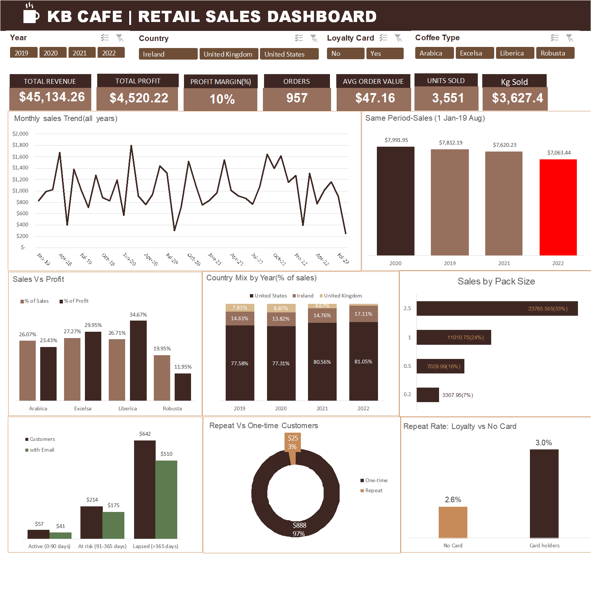
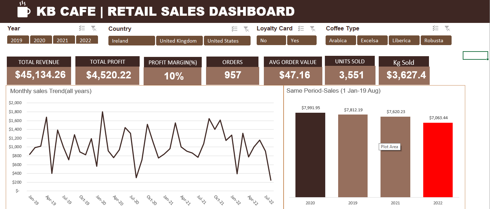
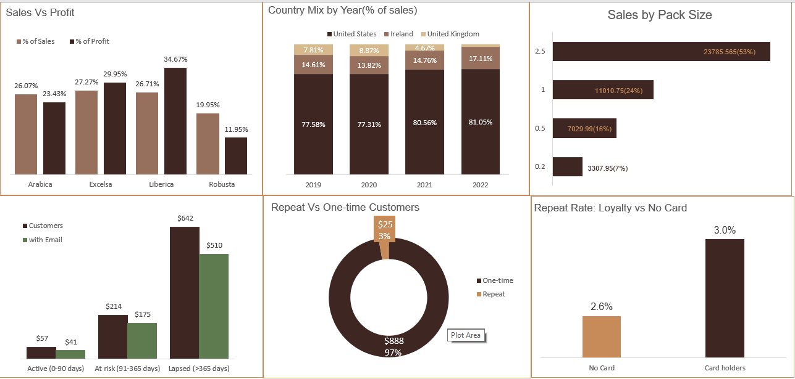

# ☕ KB Cafe | Retail Sales Dashboard


An interactive Excel dashboard that turns 1,000 raw coffee-order lines into a single view of **revenue, profit, product mix, geography and customer retention** for KB Cafe, a coffee retailer selling to the United States, Ireland and the United Kingdom.



   ### 👉 **Live preview:** [Open the interactive dashboard in your browser](https://view.officeapps.live.com/op/view.aspx?src=https%3A%2F%2Fraw.githubusercontent.com%2FAdeeTheAnalyst%2Fkb-cafe-sales-dashboard%2F3c6d2df3144aebb6b9a76ea5ded4800bfc7c17dc%2FKB_Cafe_Dashboard.xlsx&wdOrigin=BROWSELINK)

---

## Table of Contents

1. [Business Problem](#1-business-problem)
2. [Key Findings at a Glance](#2-key-findings-at-a-glance)
3. [Dataset](#3-dataset)
4. [Approach & Methodology](#4-approach--methodology)
5. [Dashboard Guide](#5-dashboard-guide)
6. [Detailed Insights](#6-detailed-insights)
7. [Recommendations](#7-recommendations)
8. [Limitations & Assumptions](#8-limitations--assumptions)
9. [How to Use This Project](#9-how-to-use-this-project)
10. [Repository Structure](#10-repository-structure)
11. [Skills Demonstrated](#11-skills-demonstrated)
12. [Author & Contact](#12-author--contact)

---

## 1. Business Problem

KB Cafe's order data lived in three separate tables (orders, customers, products), so management had no quick way to answer basic questions. This project joins them into one model and answers:

- **How is the business performing?** Revenue, profit, margin, orders and average order value, overall and over time.
- **Is 2022 on track?** A like-for-like comparison against the same calendar period in earlier years.
- **What should we sell more of?** Which coffee types and pack sizes drive revenue, and which drive *profit*.
- **Where do customers come from?** How the country mix has shifted year to year.
- **Are customers coming back?** Repeat vs one-time buyers, the effect of the loyalty card, and how long since each customer last ordered.

## 2. Key Findings at a Glance

| Metric | Value |
|---|---|
| Total revenue | **$45,134.26** |
| Total profit | **$4,520.22** (10% margin) |
| Orders | **957** from **913** customers |
| Average order value | **$47.16** |
| Units / kg sold | **3,551** units / **3,627.4 kg** |
| Data period | 2 Jan 2019 to 19 Aug 2022 |

**Top takeaways**

1. 🏆 **Liberica is the profit engine.** It makes up 26.7% of sales but **34.7% of profit**. Robusta is the reverse: 20.0% of sales but only **12.0% of profit**.
2. 📦 **Large bags dominate.** The 2.5 kg pack alone is **53% of revenue**.
3. 🇺🇸 **The business is increasingly US-centric.** The US share of sales rose from 77.6% (2019) to 81.1% (2022), while the UK fell from 7.8% to under 2%.
4. 📉 **2022 is the weakest year on a like-for-like basis.** Sales from 1 Jan to 19 Aug 2022 were **$7,063**, about 7% below the same window in 2021 and the lowest of the four years.
5. 🔁 **Retention is the biggest opportunity.** **97% of customers have bought only once**, and **70% have not ordered in over a year**. The loyalty card makes almost no difference to repeat rate (3.0% vs 2.6%).

## 3. Dataset

The raw file (`KB_Cafe_Raw_Dataset.xlsx`) has three sheets:

| Sheet | Rows | Grain | Key columns |
|---|---|---|---|
| `orders` | 1,000 | One row per product line in an order | Order ID, Order Date, Customer ID, Product ID, Quantity |
| `customers` | 1,000 | One row per customer | Customer ID, Name, Email, Phone, Address, City, Country, Postcode, Loyalty Card |
| `products` | 48 | One row per product (4 coffee types × 3 roasts × 4 sizes) | Product ID, Coffee Type, Roast Type, Size (kg), Unit Price, Price per 100g, Profit |

**Quick facts**

- 957 unique orders across 1,000 order lines (about 3% of orders contain more than one product line).
- 913 of the 1,000 customers placed at least one order.
- 726 of the 913 ordering customers (80%) have an email address on file.
- Coffee types: Arabica, Robusta, Liberica, Excelsa. Roasts: Light, Medium, Dark. Pack sizes: 0.2, 0.5, 1 and 2.5 kg.
- No missing values in the fields used for analysis after joining the tables.

> The `orders` sheet in the raw file contains only the five source columns. The enrichment columns (customer name, country, coffee type, sales, profit and so on) are populated by formulas inside the dashboard workbook, described below.

## 4. Approach & Methodology

All work was done in **Microsoft Excel**, with no macros and no external add-ins.

**Step 1: Build the data model.** Orders were turned into an Excel Table (`Coffee_data`) and enriched with lookups:

- `VLOOKUP` pulls customer name, email, country and loyalty status from `customers` using Customer ID.
- `INDEX` / `MATCH` pulls coffee type, roast, size, unit price and unit profit from `products` using Product ID.
- A `Lists` sheet maps short codes (e.g. `Ara`, `L`) to readable labels (Arabica, Light).

**Step 2: Engineer analysis fields.** Calculated columns added to the table:

| Field | Logic | Used for |
|---|---|---|
| `Sales` | Quantity × Unit Price | Revenue |
| `Profit` | Quantity × unit profit | Profit and margin |
| `Kg Sold` | Quantity × pack size | Volume |
| `Year`, `Month`, `Quarter`, `Month Start` | Derived from Order Date | Time analysis |
| `Order Flag` | 1 on the first row of each Order ID, else 0 | Counting orders without double-counting multi-line orders |
| `Customer Flag` | 1 on a customer's first row, else 0 | Counting unique customers |
| `Lines In Order`, `Basket Type` | Count of rows per Order ID | Single vs multi-item baskets |
| `Customers Orders`, `Customer Type` | Orders per customer; Repeat if more than 1 | Repeat vs one-time analysis |
| `Last Order Date`, `Days Since Last Order` | `MAXIFS` per customer, measured to the latest date in the data | Recency |
| `Recency Segment` | Active (0-90 days), At risk (91-365), Lapsed (over 365) | Customer health |
| `Email customer flag` | Unique customer with an email on file | Marketing reach |
| `In same period` | Order falls on or before the data's end month and day | Like-for-like year comparison |

**Step 3: Summarise with PivotTables.** 14 PivotTables on the `Pivot_tables` sheet feed every chart and KPI card.

**Step 4: Design the dashboard.** KPI cards, 8 charts and 4 slicers (Year, Country, Loyalty Card, Coffee Type) on one screen, in a coffee-inspired palette. All slicers filter every visual, so any KPI or chart can be sliced by market, product or customer type.

## 5. Dashboard Guide

**Filters (top):** Year · Country · Loyalty Card · Coffee Type

**KPI cards:** Total Revenue · Total Profit · Profit Margin % · Orders · Average Order Value · Units Sold · Kg Sold

| Visual | Question it answers |
|---|---|
| Monthly sales trend (all years) | What does demand look like over time, and is there seasonality? |
| Same-period sales (1 Jan to 19 Aug) | Is the current year ahead or behind previous years on a like-for-like basis? |
| Sales vs profit by coffee type | Which products earn more profit than their share of sales suggests? |
| Country mix by year (% of sales) | Is the market mix changing? |
| Sales by pack size | Which bag sizes drive revenue? |
| Customer recency (customers vs with email) | How many customers are active, at risk or lapsed, and how many can we email? |
| Repeat vs one-time customers | What share of customers come back? |
| Repeat rate: loyalty card vs no card | Does the loyalty card improve retention? |




## 6. Detailed Insights

### Sales trend and 2022 performance

| Year | Revenue | Profit | Orders |
|---|---|---|---|
| 2019 | $12,187 | $1,230 | 245 |
| 2020 | $12,118 | $1,193 | 257 |
| 2021 | $13,766 | $1,389 | 297 |
| 2022 (to 19 Aug) | $7,063 | $708 | 158 |

- Revenue was flat from 2019 to 2020, then grew about **13.6% in 2021**.
- Because 2022 only runs to 19 August, the dashboard compares the same window (1 Jan to 19 Aug) across years: $7,992 (2020), $7,812 (2019), $7,620 (2021) and **$7,063 (2022)**. 2022 is roughly 7% behind 2021 on this basis.
- Monthly sales are volatile, ranging from roughly $300 to $1,800. The final point on the trend line is a **partial month** (August 2022, data ends on the 19th), so the sharp drop at the end should not be read as a collapse.

### Product performance: sales vs profit

| Coffee type | % of sales | % of profit | Margin |
|---|---|---|---|
| Liberica | 26.7% | **34.7%** | 13% |
| Excelsa | 27.3% | 29.9% | 11% |
| Arabica | 26.1% | 23.4% | 9% |
| Robusta | 20.0% | **12.0%** | 6% |

Sales are spread fairly evenly across the four types, but profit is not. Liberica and Excelsa together generate about **65% of profit** from 54% of sales.

### Pack size

| Size | Revenue | Share |
|---|---|---|
| 2.5 kg | $23,786 | 53% |
| 1 kg | $11,011 | 24% |
| 0.5 kg | $7,030 | 16% |
| 0.2 kg | $3,308 | 7% |

Customers buying large bags account for over half of revenue, so the business leans towards bulk or trade-style purchasing.

### Geography

| Year | United States | Ireland | United Kingdom |
|---|---|---|---|
| 2019 | 77.6% | 14.6% | 7.8% |
| 2020 | 77.3% | 13.8% | 8.9% |
| 2021 | 80.6% | 14.8% | 4.7% |
| 2022 | 81.1% | 17.1% | about 1.8% |

The UK has shrunk to a marginal market, while Ireland has held up and grown in share.

### Customer retention

- **913 customers**, of whom **888 (97%) are one-time** buyers and **25 (3%) are repeat** buyers.
- **Loyalty card:** repeat rate is **3.0% for cardholders vs 2.6% without** (13 of 443 vs 12 of 470). The gap is about one customer, so the card is not visibly driving loyalty.
- **Recency** (measured to 19 Aug 2022): **57 active (6%)**, **214 at risk (23%)**, **642 lapsed (70%)**.
- **510 of the 642 lapsed customers (79%) have an email on file**, so most of the win-back audience is directly reachable.

## 7. Recommendations

These are the actions the data points to, in rough priority order:

1. **Launch a win-back campaign** to the 510 lapsed customers with an email on file, and a lighter nudge to the 175 at-risk customers with email. This is the largest, cheapest source of recoverable revenue.
2. **Promote Liberica and Excelsa**, which deliver the highest margins, through featured placement, bundles and bulk-size offers.
3. **Review Robusta pricing or cost.** It is a fifth of sales but only 12% of profit at a 6% margin.
4. **Redesign the loyalty programme.** A card alone does not change repeat behaviour. Test points, subscription or reorder reminders, especially for 2.5 kg buyers.
5. **Investigate the 2022 shortfall and the UK decline** (pricing, shipping, competition, marketing spend) before committing budget to either.
6. **Capture more emails** at checkout. 20% of customers cannot currently be contacted.

## 8. Limitations & Assumptions

- **Profit is rule-based, not measured.** In the `products` table, unit profit equals a fixed percentage of price by coffee type (Robusta 6%, Arabica 9%, Excelsa 11%, Liberica 13%). Margin differences between coffee types therefore reflect that assumption rather than independent cost data, and should be validated against real costs before pricing decisions.
- **Partial final year.** Data ends 19 Aug 2022. Full-year 2022 figures are not available, which is why a same-period comparison is used.
- **Recency is relative to the last date in the data** (19 Aug 2022), not today's date.
- **Small sample.** 1,000 order lines and 25 repeat customers. The repeat-rate comparison between cardholders and non-cardholders is directional only and not statistically conclusive.
- **No customer acquisition, cost or marketing data**, so channel ROI and true customer lifetime value cannot be assessed.
- 87 customers in the `customers` table have no orders and are excluded from customer-level metrics.

## 9. How to Use This Project

**Requirements:** Microsoft Excel 2019 or Microsoft 365 for Windows or Mac. The workbook uses `MAXIFS` and slicers, so older Excel versions and Google Sheets may not display it correctly.

1. Download `dashboard/KB_Cafe_Dashboard.xlsx`.
2. Open it and click **Enable Editing**.
3. Go to the **Dashboard** sheet and use the slicers (Year, Country, Loyalty Card, Coffee Type) to filter every KPI and chart. Click the funnel icon on a slicer to clear it.
4. To explore the logic, open `Orders` (calculated columns), `Pivot_tables` (all aggregations), `Products`, `Customers` and `Lists`.
5. If you add or edit data, go to **Data → Refresh All** to update the PivotTables.

To rebuild from scratch, start with `data/KB_Cafe_Raw_Dataset.xlsx` and follow the steps in [Approach & Methodology](#4-approach--methodology).

## 10. Repository Structure

```text
kb-cafe-sales-dashboard/
├── README.md
├── dashboard/
│   └── KB_Cafe_Dashboard.xlsx      # Final interactive dashboard (6 sheets)
├── data/
│   └── KB_Cafe_Raw_Dataset.xlsx    # Raw orders, customers and products
└── images/
    ├── dashboard-overview.png      # Full dashboard screenshot
    └── dashboard-charts.png        # Chart section screenshot
```

**Workbook sheets:** `Dashboard` · `Pivot_tables` · `Orders` · `Customers` · `Products` · `Lists`

## 11. Skills Demonstrated

- **Data modelling:** joining fact and dimension tables with `VLOOKUP` and `INDEX`/`MATCH`
- **Feature engineering:** calculated columns for flags, segments and like-for-like periods using `COUNTIF`, `SUMIFS`, `MAXIFS`, `DATEDIF`
- **Aggregation and analysis:** PivotTables, calculated fields, year-on-year and same-period comparison
- **Customer analytics:** repeat vs one-time analysis, recency segmentation, loyalty programme assessment
- **Dashboard design:** KPI cards, interactive slicers, consistent colour palette and clear chart titles
- **Business communication:** turning numbers into findings and recommendations

## 12. Author & Contact

Sherifat Adeshina
Data Analyst

- LinkedIn: [https://www.linkedin.com/in/adeshina-sherifat](https://www.linkedin.com/in/adeshina-sherifat)
- Portfolio: [https://medium.com/@eyinadeadeshina36/list/from-data-to-decision-making-561ab26ca151](https://medium.com/@eyinadeadeshina36/list/from-data-to-decision-making-561ab26ca151)
- Email: [eyinadeadeshina36@gmail.com](mailto:eyinadeadeshina36@gmail.com)

If you found this project useful or have feedback, feel free to open an issue or get in touch.

## License

Released under the [MIT License](LICENSE). The dataset is included for demonstration and learning purposes.
